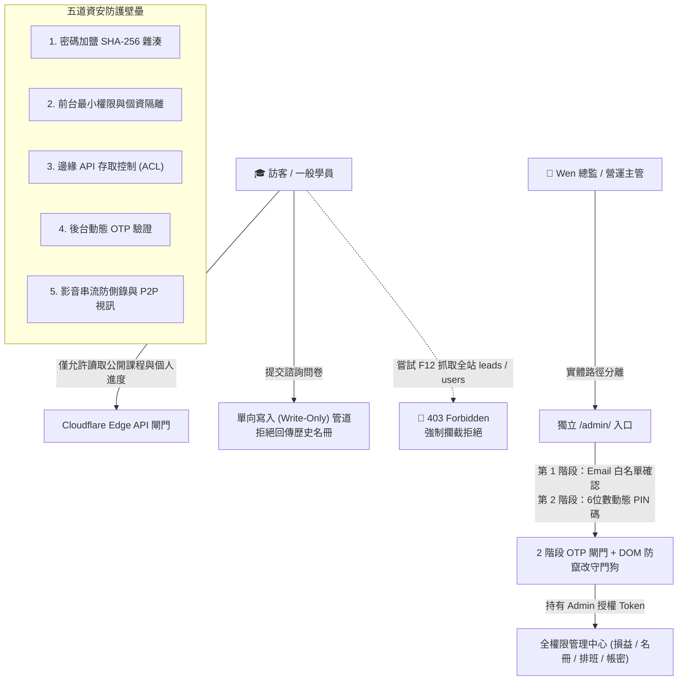

# 🛡️ 精五門 (PentaSkill) — 企業級資安防護與個人資料隱私規範手冊

> **本文件旨在向精五門平台全體營運夥伴（Wen 總監、陳顧問、營運員工、金牌講師）完整說明本站之資訊安全、個資保護與技術防護機制。**  
> 全站資安架構比照國際 **OWASP Top 10** 安全規範，並參考 **WordPress** 與 **Shopline** 之企業級電商與會員防護標準，落實深度防禦（Defense in Depth），全面保障學員隱私、講師機敏資訊與公司商業機密。

---

## 📑 目錄
1. [架構總覽：五道全方位安全防線](#-1-架構總覽五道全方位安全防線)
2. [第一道防線：密碼加密與無痛升級機制](#-2-第一道防線密碼加密與無痛升級機制)
3. [第二道防線：學員個資與前台最小權限隔離](#-3-第二道防線學員個資與前台最小權限隔離)
4. [第三道防線：Cloudflare Workers 邊緣 API 存取控制](#-4-第三道防線cloudflare-workers-邊緣-api-存取控制)
5. [第四道防線：管理者後台 2 階段動態 OTP 與防竄改守門狗](#-5-第四道防線管理者後台-2-階段動態-otp-與防竄改守門狗)
6. [第五道防線：Cloudflare Stream 影音串流與 1 對 1 通訊安全](#-6-第五道防線cloudflare-stream-影音串流與-1-對-1-通訊安全)
7. [台灣《個人資料保護法》合規實務對照表](#-7-台灣個人資料保護法合規實務對照表)
8. [營運團隊夥伴日常資安守則 (SOP)](#-8-營運團隊夥伴日常資安守則-sop)

---

## 📌 1. 架構總覽：五道全方位安全防線

精五門全平台採用「多層次深度防禦架構」，杜絕單點故障（No Single Point of Failure），確保任一環節即使遭遇惡意嘗試，其他防護層也能滴水不漏地阻隔威脅：

---

## 🔑 2. 第一道防線：密碼加密與無痛升級機制

### 2.1 嚴格廢除純文字明文密碼（OWASP 標準）
- **核心原則**：全站原始碼、前端暫存（LocalStorage）與雲端資料庫（Cloudflare KV），**100% 絕不出現或儲存任何純文字明文密碼**。
- **加鹽雜湊演算法**：採用 Web Crypto 原生的高效加密標準 `SHA-256` 結合專屬安全鹽值（`PentaSkill_2026_Salt`），有效抵禦彩虹表碰撞（Rainbow Table Attack）與暴力破解。
- **儲存規格**：密碼於記憶體中一律轉化為 64 位數十六進位不可逆雜湊字串（例如：`864a27998d99c2...`）。

### 2.2 舊帳號平滑無痛升級機制
- 為保障現有學員與種子用戶的使用體驗，系統內建相容驗證引導：
  1. 使用者輸入密碼登入時，系統在瀏覽器端記憶體計算加鹽雜湊。
  2. 若資料庫內為舊版歷史密碼，通過核驗後，系統會於背景**自動升級為 SHA-256 雜湊**並寫入持久儲存。
  3. 整個升級過程學員**零感知、不跳錯誤、無需重新設定**，自然過渡至最高資安等級。

---

## 👤 3. 第二道防線：學員個資與前台最小權限隔離

### 3.1 比照 WordPress / Shopline 前台設計原則
電商巨擘 Shopline 與主流 CMS WordPress 均嚴格實施「前後台最小權限分離原則」：前台客戶端只提供商品陳列與顧客個人專區，絕不向瀏覽器廣播全站客戶名冊。

### 3.2 徹底切斷前台開機下載全站名單之漏洞
- **修復前風險**：過去前台載入時，曾將雲端所有用戶名單與諮詢名冊下載至瀏覽器快取，導致透過 F12 可能看到其他學員的手機與 Email。
- **現行加固防護**：
  1. 前台 `initCloudSync()` **嚴格僅拉取**三項公開資訊：
     - 公開課程大綱（`courses`）
     - 公開章節單元（`chapters`）
     - 隨課教材清單（`course_materials`）
  2. **全面切斷前台對敏感表的請求**：一般學員瀏覽器完全不抓取、不暫存 `leads`（潛在名單）、`users`（全體帳號）、`custom_quotes`（客製報價單）、`staff_salaries`（員工薪資）與 `platform_expenses`（平台支出）。
  3. **個人進度隔離**：學員登入後，系統僅依該學員 Email 單獨存取專屬進度鍵值（`video_progress_{email}`），學員之間資料 100% 獨立隔離。

### 3.3 原始碼與示範資料去識別化（Data De-identification）
- 靜態檔案中的示範聯絡資料全面進行去識別化處理，手機一律遮蔽中段（如 `0912-***-001`），測試 Email 全面替換為沙盒專用網域（`@pentaskill.demo`），杜絕任何真實個資被爬蟲收錄。

---

## ☁️ 4. 第三道防線：Cloudflare Workers 邊緣 API 存取控制

精五門後端全面託管於 Cloudflare 全球邊緣伺服器，直接在網路入口處進行存取控制（Role-Based Access Control / ACL）：

| 資源名稱 / Key | 權限等級 | 存取控制規則 (ACL) |
|---|---|---|
| **公開課程 (`courses`, `chapters`, `course_materials`)** | 🟢 公開讀取 | 許可網域內所有訪客與學員可直接讀取，無須 Token。 |
| **個人看課進度 (`video_progress_*`)** | 🟡 個人專屬 | 僅允許對應 Email 之已登入學員讀取與更新。 |
| **潛在學員諮詢 (`leads`)** | 🔒 單向寫入 (Write-Only) | **前台僅能 POST（新增諮詢），嚴格禁止未授權 GET（讀取名冊）**。若嘗試透過 API 下載名冊，直接回傳 `403 Forbidden`。 |
| **機敏營運資料 (`users`, `salaries`, `quotes`, `expenses`)** | 🔴 核心機敏 | **必須持有通過 OTP 審核之管理員授權權杖 (`X-PentaSkill-Auth`)**，否則邊緣 Worker 直接阻斷。 |

### 4.1 單向安全表單機制 (Write-Only Inquiries)
學員在官網填寫諮詢問卷或索取試聽時，前端以單向形式追加（Append-Only）送入資料庫與 Google Apps Script Webhook，前台介面無法回查任何歷史名單，徹底消滅名單被批次竊取的管道。

---

## 🏰 5. 第四道防線：管理者後台 2 階段動態 OTP 與防竄改守門狗

### 5.1 實體後台路徑分離與強制重導向
- 官網前台與營運後台在目錄層級實體隔離（`/admin/`）。
- 若有一般訪客或學員在首頁嘗試手動切換至後台 Hash（`#admin-dashboard`），系統自動強行將其重導向至獨立的 `/admin/` 入口，絕不留在前台頁面渲染機敏元件。

### 5.2 嚴格 2 階段動態驗證碼 (Two-Stage Dynamic OTP)
進入後台必須通過嚴格的二階段防禦：
1. **第 1 階段：身分審核**：
   - 進入後台預設全面鎖定（`#adminPinGate`），管理者必須先手動輸入被授權的主管 Email（Wen 總監、陳顧問、營運主管）。
   - 若輸入不在授權白名單內的信箱，畫面直接顯示紅色拒絕警告，**嚴禁觸發任何發信行為**，防止惡意撞庫。
2. **第 2 階段：動態 PIN 碼派發與解鎖**：
   - 通過白名單檢核後，系統才向該信箱寄發 6 位數一次性動態驗證碼，並啟動 60 秒防刷重發倒數。
   - 動態碼核驗通過後立即銷毀（單次有效，防範重放攻擊），方能解鎖管理中心。

### 5.3 防竄改 DOM 守門狗（Anti-Tampering Watchdog）
- 針對瀏覽器開發者工具（DevTools）植入主動防禦：
  - 每秒心跳檢查＋`MutationObserver` 實時監控。
  - 若有未授權人員嘗試手動在 F12 刪除 `#adminPinGate` 節點或將其樣式強行改為 `display: none`，守門狗會瞬間觸發「主動銷毀阻斷」，清空 DOM 結構並強制畫面鎖定，徹底粉碎前端繞過攻擊。

---

## 🎬 6. 第五道防線：Cloudflare Stream 影音串流與 1 對 1 通訊安全

針對影音資產保護與線上視訊教學的安全性，全站具備高度合規的串流防護：

### 6.1 錄播影片（Cloudflare Stream）
- **全球邊緣 CDN 無流量上限**：無傳統伺服器流量頻寬天花板，依賴 Cloudflare 全球 300+ 城市節點加速，學員在任何網路穩定之處皆可順暢看課。
- **自適應串流（Adaptive Bitrate / HLS）**：影片拆分為安全微切片，隨學員頻寬動態在 1080p、720p、480p 平滑調整，不會轉圈中斷。
- **防盜鏈與防任意下載**：影片非一般公開 `.mp4` 檔案下載連結，而是透過專屬 Player 串流解碼播放，有效防止直接複製網址下載外流。

### 6.2 1 對 1 個教視訊教學（WebRTC P2P）
- **點對點端到端加密**：老師與學員之間的影像、語音與螢幕共享，主要採 WebRTC 點對點連線，不經過平台伺服器轉發與儲存，**平台伺服器零頻寬負擔且具備極高通訊隱私**。
- **10 分鐘入場時效守門員**：開課前超過 10 分鐘前，系統防呆阻擋提前誤入；遲到時不順延下課時間，兼顧隱私與排班秩序。
- **雙向身分角色解耦**：視訊畫面動態綁定預約名單真實學員與授課業師，防止身分錯置。

---

## 📜 7. 台灣《個人資料保護法》合規實務對照表

精五門平台全面遵循台灣《個人資料保護法》第 8 條、第 9 條、第 19 條與第 27 條之技術安全維護標準：

| 法規規範要點 | 精五門平台對應之落實措施 | 合規狀態 |
|---|---|---|
| **第 8 條：明確告知與法定目的** | 購課結帳前強制彈出【購課服務條款與退費政策】（含個資蒐集目的告知），學員必須主動勾選同意方可送出。 | ✅ 100% 合規 |
| **第 27 條：採取適當安全維護措施** | 密碼實施 SHA-256 加鹽雜湊化；銀行帳戶全面脫敏隱藏中段（僅保留末五碼）；全站強制 HTTPS 加密傳輸。 | ✅ 100% 合規 |
| **最小化蒐集原則 (Data Minimization)** | 學員註冊僅保留必要之 6 大欄位（姓名、稱呼、電話、Email、密碼、生日）；前台開機嚴格禁止拉取全體會員名單。 | ✅ 100% 合規 |
| **防止外部越權存取與竊取** | Cloudflare Workers 實施 ACL 權杖驗證；機敏表 `GET` 拒絕未授權存取（回傳 403）；後台實體路徑分離並設 2 階段 OTP 閘門。 | ✅ 100% 合規 |
| **資料當事人權利保障** | 學員專區設有「修改個人資料」功能，可隨時線上檢視、更正手機、Email、生日與密碼。 | ✅ 100% 合規 |

---

## 👥 8. 營運團隊夥伴日常資安守則 (SOP)

平台技術防護已臻完善，但資安最關鍵的一環仍仰賴全體夥伴在日常操作時的謹慎配合：

### 👑 主管與顧問夥伴（Wen 總監、陳顧問）
1. **動態 PIN 碼信件保護**：後台登入收到的 6 位數 OTP 動態碼僅供本人當次輸入使用，**切勿轉傳給他人或貼在公共群組**。
2. **公用電腦隨手登出**：於非個人電腦（如展示機、會議室電腦）檢視財務報表或排班時，離開前務必點擊右上角「🔒 上鎖」或「🚪 登出」。
3. **備份檔案妥善保管**：匯出的財務報表 CSV 或全域備份檔，請儲存於具密碼保護之私人裝置，避免存放在公開共享雲端資料夾。

### 🧑‍💼 營運員工夥伴（專案經理、客服小編、助教）
1. **學員諮詢隱私維護**：在 LINE@ 客服接洽學員時，嚴禁將學員的手機、Email 或諮詢備註截圖公開發布至社群媒體。
2. **客製報價單核對**：手動開立專屬報價單時，請仔細核對學員的 Email 與電話，確保特惠方案與折扣金額精準送達本人。
3. **密碼不隨意借用**：每位員工皆有獨立的帳號密碼，請勿私下借調密碼使用。

### 👨‍🏫 金牌講師夥伴
1. **學員上課專屬隱私**：1 對 1 個教時，學員之姓名、作品集與練習專案為學員個人資產，未經學員明確書面同意，請勿擅自錄影公開於個人頻道。
2. **教材智慧財產權保障**：上傳至講師工作台之隨課講義（PDF / Word / PPT），平台下載時均會自動加蓋**「精五門官方防偽浮水印」**與學員姓名，保障講師心血不被惡意散佈。
3. **穩定網路環境建議**：授課前請確保網路連線順暢（優先使用家用有線網路或 5G Wi-Fi），並請善用**課前 10 分鐘提前進入教室**測試麥克風與螢幕分享。

---

> 💡 **總結**：資訊安全不是阻礙營運的繁瑣規則，而是守護學員信任與精五門長遠發展的堅固基石。全體夥伴若有任何資安疑慮或異常反饋，請隨時回報平台技術總監！
